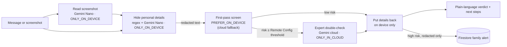

# Kinguard: is this a scam?

**A private scam checker for older adults and the families who look out for them.** Paste a text, email or screenshot and Kinguard tells you, in plain words, whether it's a scam and exactly what to do. Your personal details never leave your device.

Built for **#BuildHybridAI 2026** with **Firebase AI Logic hybrid inference** on two platforms: **Gemini Nano on-device in Chrome**, and a **native iPhone app** pairing Apple's on-device model with Gemini through Firebase AI Logic. The cloud is used only when needed, and only on text that has already had your personal details removed.

> 🌐 **Live app: https://kinguard-3e9fb.web.app** · 🎬 Demo video: _add YouTube link_ · 🧩 Chrome extension: [`/extension`](extension) · 📱 iPhone app: [`/ios`](ios)

## How to test it (judges)

1. Open **https://kinguard-3e9fb.web.app** in Chrome. No account is needed to check messages.
2. Tap a sample scam (for example "Grandson in jail") and press **Check it**. Open **How Kinguard checked this** to see which steps ran on your device and the exact redacted text the cloud received.
3. On Chrome desktop with Gemini Nano enabled (see below), the pill at the top turns green and the private steps run on-device. Without it, Kinguard falls back to the cloud on redacted text, so it works everywhere.
4. **Family:** sign in with Google, create a circle, open **Invite** and join from a second Google account (another browser or incognito). Tap **Tell my family** on a result: the other account gets a live alert banner.
5. **iPhone:** the native app is shown in the demo video. To build it yourself, see [`ios/README.md`](ios/README.md) (needs a Mac with Xcode 27 and your own Firebase project).

---

## Why it matters

Older adults are the most-targeted group for phone, text and email fraud, and they lose the most money per incident. The messages are personal by nature: they contain names, phone numbers, account numbers and verification codes. "Paste it into a chatbot" is exactly the wrong habit to teach someone who is being scammed.

Kinguard is built around one promise: **the cloud only ever sees a version of the message with your details hidden, and you can see exactly what it saw.**

## How hybrid inference is used (and why each split exists)



| Step | Firebase AI Logic mode | Why |
|---|---|---|
| Read screenshot | `ONLY_ON_DEVICE` (multimodal Gemini Nano) | Screenshots are full of private details. If the device can't do it, Kinguard **asks** before using the cloud. |
| Find names and addresses | `ONLY_ON_DEVICE` | This step sees the raw text, so it must never fall back to the cloud. It is combined with on-device regex for phones, emails, cards (Luhn-checked), SSNs, account numbers and URL query strings. |
| First-pass scam screen | `PREFER_ON_DEVICE` | Instant, free and works offline. On phones and other browsers it falls back to `gemini-3.5-flash-lite` automatically, and it only ever receives redacted text. |
| Expert double-check | `ONLY_IN_CLOUD` (`gemini-3.8-flash`) | Runs only when the first pass crosses a risk threshold set in **Remote Config**, or when the user asks. It gets redacted text and writes clear next steps. |
| Re-hydration | Local code | Placeholders like `[PHONE_1]` in the cloud answer are swapped back on-device, so advice like "don't call 415-555-0182" is personal without the cloud ever knowing the number. |

All four models use **structured output**: the same `Schema` is passed as `responseSchema` (cloud) and `responseConstraint` (Nano), so both paths return identical JSON. Every response's `inferenceSource` is recorded in a **privacy ledger** that the user can open ("How Kinguard checked this") to see what ran where and the exact text that was sent.

**Where Firebase AI Logic is called:** [`web/src/ai/engine.ts`](web/src/ai/engine.ts) (`getGenerativeModel` with `InferenceMode`, `initializeDeviceModel`, `generateContent`), orchestrated by [`web/src/ai/pipeline.ts`](web/src/ai/pipeline.ts). Initialization with App Check is in [`web/src/firebase.ts`](web/src/firebase.ts).

## Features

- **Check anything:** paste text, add or paste a screenshot, share from Android's share sheet (installable PWA with a share target), or right-click → **Check with Kinguard** in Chrome (extension).
- **Plain-language verdicts** for older adults: large text, a risk meter, warning signs with reasons, numbered next steps, "how to check for yourself".
- **Read this to me with Kokoro:** the Kokoro-82M text-to-speech model runs **on the device** in a Web Worker (WASM), so results are read aloud in a natural voice and the text never leaves the device for speech either. It is a one-time download of about 90 MB, with four voices and adjustable speed, and falls back to the browser's voice.
- **Works offline:** with Gemini Nano, checks run with no internet. The expert double-check runs automatically when you reconnect.
- **Never stuck:** no on-device model goes to the cloud on redacted text, and no model at all falls back to built-in rules.
- **Family circles** (Google sign-in + Firestore), a family-safety hub:
  - A member list with avatars, roles (owner, admin, member), who is *protected*, and live status ("All clear · 2h ago", "Caught a likely scam · 12m ago").
  - Invite codes for *someone to protect* or *a helper*. Codes **expire after 48 hours**, can be **cancelled**, and can be shared by link (`/join/CODE`).
  - **Up to 8 people per circle.** Owners and admins remove members, the owner promotes admins, and anyone can leave. Multiple circles come with a switcher.
  - High-risk results from protected members alert the circle automatically, and anyone can tap **Tell my family**. Other members get a live in-app banner (plus a system notification if the app is in the background), and helpers tap **I'll call**.
  - Everything is **enforced server-side by Firestore security rules**: member cap, roles, invite validity, and alerts that can only contain the redacted verdict.
  - Checking messages never needs an account. Circles need Google sign-in so they persist across devices, and an anonymous session is upgraded in place.
- **Live-tunable routing** (Remote Config): escalation threshold, family alert threshold, cloud models, and low-confidence escalation, all changeable without shipping a new build.
- **Local link inspection:** look-alike brand domains (`amaz0n-…`), risky TLDs, shorteners, punycode, bare IPs and insecure links.
- **History** stays on the device.

## Platforms

| Platform | What runs where |
|---|---|
| **Chrome desktop** (web app + extension) | Full hybrid: Gemini Nano on-device, cloud for escalation |
| **iPhone** (native SwiftUI app, iOS 27) | Full hybrid: Apple's on-device model (Foundation Models) for redaction and first pass, Gemini via Firebase AI Logic for fallback and the expert check; Vision OCR on-device; same family circles |
| **Android and other browsers** (installable PWA + share target) | Redaction on-device, AI in the cloud via the same hybrid model's automatic fallback |
| **Any device, offline** | Built-in rules (and Gemini Nano where available) |

## Run it locally

Requirements: Node 20+ and a Firebase project (free Spark plan works for the default models).

```bash
cd web
cp .env.example .env      # fill in your Firebase web config + App Check key/debug token
npm install
npm run dev               # http://localhost:5173
npm test                  # 22 unit tests, including privacy guarantees
```

Full Firebase setup (AI Logic, App Check, Auth, Firestore, Remote Config, Hosting) is in **[docs/SETUP.md](docs/SETUP.md)**.

**Turn on Gemini Nano in Chrome:** Chrome 139+ desktop → `chrome://flags/#prompt-api-for-gemini-nano-multimodal-input` → Enabled → restart, then press **Turn on private AI** in Kinguard.

**Chrome extension:** `chrome://extensions` → Developer mode → **Load unpacked** → select `extension/`. Open the extension's options to set your Kinguard URL.

## Project layout

```
web/src/firebase.ts        Firebase + App Check + AI Logic + Firestore + Remote Config init
web/src/config.ts          Remote Config routing policy
web/src/ai/engine.ts       Firebase AI Logic models and inference modes
web/src/ai/pipeline.ts     hybrid pipeline (read → redact → triage → route → deep check → rehydrate)
web/src/ai/schemas.ts      shared structured-output schemas (cloud + Nano)
web/src/local/redact.ts    on-device PII redaction and re-hydration
web/src/local/links.ts     on-device link inspection
web/src/local/rules.ts     offline rules fallback
web/src/family/account.ts  Google sign-in (anonymous upgrade)
web/src/family/circles.ts  circles, members, invites, alerts (Firestore)
web/src/voice/             Kokoro on-device TTS (Web Worker)
web/public/sw.js           offline shell + Android share target
extension/                 Chrome MV3 extension
ios/Kinguard/              native iPhone app (SwiftUI, Foundation Models + Firebase AI Logic)
firestore.rules            security rules (alerts can only contain the redacted verdict)
remoteconfig.template.json routing parameters
```

## Built during the hackathon

Everything in this repository was written during the #BuildHybridAI 2026 submission period (Nov 2026).

## License

[Apache 2.0](LICENSE). Kinguard gives guidance, not guarantees. If in doubt, hang up and call someone you trust.
